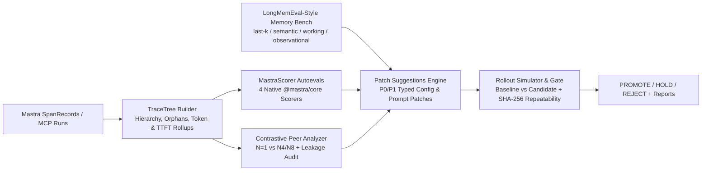

# Agent Trace Coach

**Trace Intelligence, `@mastra/core` Autoevals, Contrastive Peer Diagnostics, Memory Primitive Benchmarking, Patch Suggestions, and Gated Rollouts for Mastra Agents.**

Built in strict TypeScript on top of `@mastra/core/evals` (`createScorer`) and `@mastra/core/observability` (`SpanType`), unifying agent trajectory evaluation, `callstack/agent-device` MCP accessibility-tree testing, TRACE-inspired contrastive peer analysis, and LongMemEval-style memory benchmarking into a single reproducible Agent Learning loop.

---

## Architecture



## What This Project Demonstrates (Mapped to Mastra's Roadmap)

| Mastra Priority | Implemented Module | Key Capabilities |
| --- | --- | --- |
| **Trace Intelligence** | [`src/trace-intel/tree-builder.ts`](src/trace-intel/tree-builder.ts), [`detectors.ts`](src/trace-intel/detectors.ts), [`contrastive.ts`](src/trace-intel/contrastive.ts) | Reconstructs `SpanRecord[]` trees; detects 6 failure signatures (`TOOL_THRASH_LOOP`, `STALE_REF_DESYNC`, `SPECIFICATION_GAMING`, `MEMORY_STALE_OR_MISS`, `CASCADE_TOOL_FAILURE`, `BUDGET_AND_LATENCY_ANOMALY`); runs `N=1` vs `N4/N8` peer-divergence analysis with an anti-leakage audit and 95% Wilson CIs. |
| **Autoevals (`@mastra/core`)** | [`src/evals/scorers.ts`](src/evals/scorers.ts), [`mastra-adapter.ts`](src/evals/mastra-adapter.ts) | Implements 4 native `createScorer` pipelines (`trace-invariants`, `tool-call-efficiency`, `trajectory-integrity`, `grounding-and-memory`) over Mastra-compatible `SpanType` records. |
| **Agent Learning (`Suggestions` + `Rollouts`)** | [`src/learning/suggestions.ts`](src/learning/suggestions.ts), [`rollouts.ts`](src/learning/rollouts.ts), [`simulator.ts`](src/learning/simulator.ts) | Converts diagnosed clusters into prioritized `PatchSuggestion` specs (`agent.instructions`, `agent.processors`, `mcp.tool`, `mastra.memory`), runs baseline vs. candidate rollouts, checks canonical SHA-256 repeatability, and enforces a fail-closed promotion gate. |
| **MCP Tool & Device Verification** | [`src/mcp/agent-device-adapter.ts`](src/mcp/agent-device-adapter.ts) | Typed `callstack/agent-device` MCP contract (`open`, `snapshot`, `press`, `fill`, `close`), `createAgentDeviceMcpServerConfig()`, and a deterministic accessibility-tree simulator enforcing `--settle` diffs and `STALE_REF` rejections. |
| **Memory Primitive Benchmarking** | [`src/benchmarks/memory-bench.ts`](src/benchmarks/memory-bench.ts) | Evaluates 4 Mastra memory strategies (`last-k`, `semantic-recall`, `working-memory`, `observational-hybrid`) across 5 LongMemEval capability slices with Wilson CIs, token/latency tracking, and tuned config output. |

---

## Quick Start

Requires Node.js >= 22 (verified on Node v26.13.1).

```bash
npm install
npm run typecheck
npm run build
npm test
```

Run the full unified pipeline demo (and generate `results/report.md` and `results/report.json`):

```bash
npm run generate:results
# or after npm run build:
node dist/cli.js demo --out results
```

Other CLI subcommands:

```bash
node dist/cli.js autoeval       # Run @mastra/core MastraScorer suite over baseline traces
node dist/cli.js bench-memory   # Run LongMemEval-style memory primitive benchmark
node dist/cli.js rollout        # Run baseline vs. candidate rollout & promotion gate
```

---

## Generated Results (`results/`)

Running `npm run generate:results` dynamically produces [`results/report.md`](results/report.md) and [`results/report.json`](results/report.json) from the live TypeScript pipeline:

| Stage | Key Output |
| --- | --- |
| **Autoevals (`@mastra/core` `createScorer`)** | Catches `trace-mcp-stale-02` (`0.57`), `trace-code-hack-02` (`0.81`), and `trace-mem-stale-02` (`0.87`) across 8 baseline traces. |
| **Contrastive Peer Analysis** | Evaluator leakage audit: `PASSED (0 violations)`. `N1_SOLO` (`87.5%` acc / `75.0%` recall) -> `N4_MIXED` & `N8_MIXED` (`100.0%` acc / `100.0%` recall), catching `trace-silent-skip-02` halting early where its passing peer ran `verify_output`. |
| **Memory Primitive Benchmark** | `last-k` (`28.0%`), `semantic-recall` (`36.0%`), `working-memory` (`80.0%`), `observational-hybrid` (`92.0%`, 95% Wilson CI `[75.0%, 97.8%]`, `1850` avg tokens, `310ms` avg latency). |
| **Patch Suggestions -> Rollout Gate** | Generates 5 prioritized `[P0]`/`[P1]` patches; baseline `0/6` (`0.75` mean score, `3660` avg tokens) -> candidate `6/6` (`1.00` mean score, `3410` avg tokens), canonical SHA-256 repeatability `IDENTICAL (7394a2f5f0d3)`, verdict **`PROMOTE`**. |

### Verification & Scope

- **Real execution:** Uses `@mastra/core/evals` (`createScorer`) and `@mastra/core/observability` (`SpanType`), executes span-tree reconstruction, failure detectors, contrastive peer diffing, leakage audits, 95% Wilson CIs, and the fail-closed rollout gate.
- **Deterministic offline fixtures:** To keep CI and evaluation reproducible with zero API keys or external daemons, the default suite runs against curated `SpanRecord` fixtures and `SimulatedAgentDeviceSession` rather than live LLM calls or a live OS/browser `agent-device` binary.

---

## Project Layout

```text
src/
  contracts/schemas.ts         # Zod v4 schemas & Mastra SpanRecord-compatible contracts
  stats/wilson.ts              # 95% Wilson CIs, percentiles, canonical JSON & SHA-256 hashing
  trace-intel/
    tree-builder.ts            # SpanRecord -> TraceTree reconstruction + orphan/token/TTFT rollups
    detectors.ts               # 6 deterministic trajectory failure-signature detectors
    contrastive.ts             # TRACE-inspired peer-context analyzer + evaluator leakage audit
  evals/
    mastra-adapter.ts          # Bridges @mastra/core/observability SpanType into TraceTree
    scorers.ts                 # 4 native @mastra/core/evals createScorer pipelines
  mcp/
    agent-device-adapter.ts    # callstack/agent-device MCP config & accessibility-tree simulator
  benchmarks/
    datasets.ts                # Curated frozen trace datasets (MCP, coding, memory, subtle skip)
    memory-bench.ts            # 5-slice memory primitive benchmark & config recommender
  learning/
    suggestions.ts             # Typed PatchSuggestion generator
    simulator.ts               # Deterministic policy rollout simulator
    rollouts.ts                # Paired rollout comparison, repeatability check & fail-closed gate
  reporting/markdown.ts        # Markdown + JSON report formatter
  cli.ts                       # CLI entrypoint
tests/                         # 6 Vitest suites (12 tests) covering all modules end-to-end
docs/
  FOUNDER_PITCH.md             # 1-page founder outreach brief
```

## Lineage & Design Influences

- **Mastra (`mastra-ai/mastra`)**: Native `createScorer`, `SpanType`, `Observability`, and `explorations/longmemeval` patterns.
- **TRACE & `terminal-wrench-peer-similarity`**: Contrastive peer-trajectory classification (`N=1` vs `N4/N8`), opaque slot sanitization, and leakage checks.
- **EvalScope (`modelscope/evalscope`)**: Multi-turn agent trajectory grouping, tool-call linking, and multi-dimensional report semantics.
- **Agent Device (`callstack/agent-device`)**: Accessibility-tree snapshot/ref lifecycle (`--settle` diffs and `STALE_REF` failure modes) over MCP.
- **`visual-safety-audit` & `robo-audit-eval`**: 95% Wilson confidence intervals, canonical SHA-256 repeatability verification, and fail-closed gating.
